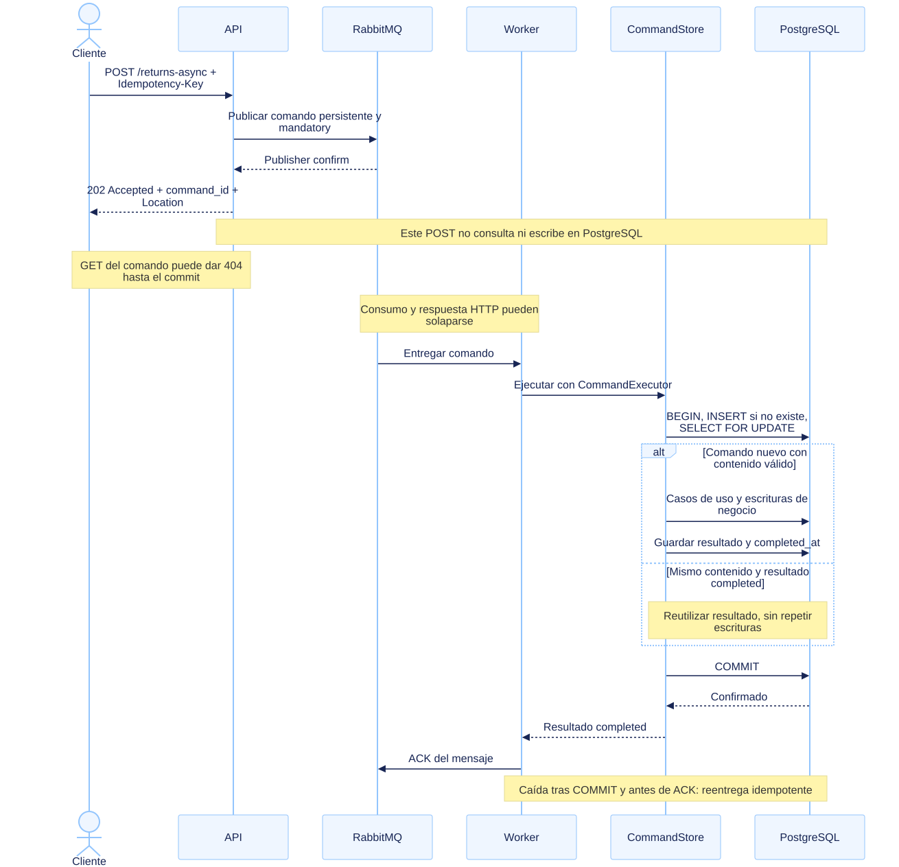
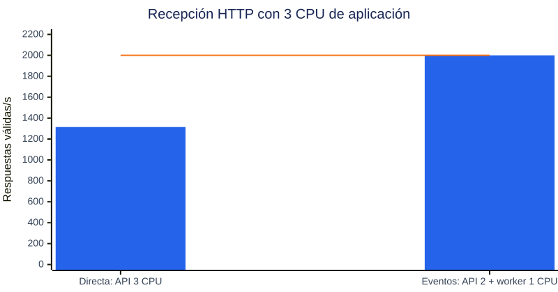

# Return-Flow

**Caso de estudio de backend: arquitectura hexagonal, idempotencia y procesamiento de devoluciones con y sin cola.**

¿Cuándo conviene responder con el resultado de una operación y cuándo confirmar su recepción para ejecutarla después? Este repositorio explora esa decisión con dos recorridos sobre el mismo dominio, pruebas de sus garantías y mediciones bajo carga.

**Python · FastAPI · PostgreSQL · RabbitMQ · Docker Compose · pytest · k6**

El escenario conecta con los retos de evolución de plataformas de devoluciones descritos en la [oferta de Product Engineer de Citibox](https://www.getmanfred.com/ofertas-empleo/8479/citibox-mid-product-engineer-backend-focus-sept26): APIs, fiabilidad, pruebas y decisiones técnicas ligadas al producto. Es un caso independiente; no representa un sistema de Citibox ni una migración real de Java/Oracle.

**Resultado principal:** con 3 CPU de aplicación, la variante con cola aceptó los 2.000 envíos/s ofrecidos; la directa recibió unos 1.315/s. Sin embargo, eventos acumuló trabajo pendiente y la directa completó más operaciones durante los primeros 15 segundos. La elección depende de cuánto pueda esperar el usuario al resultado.

[Arquitectura](docs/architecture.md) · [Pruebas](docs/testing.md) · [Rendimiento y evidencia](docs/performance.md) · [Guía de uso](docs/usage.md)

## El problema de producto

El flujo mínimo es crear una entrega, confirmarla como entregada y solicitar una devolución. Solo una entrega entregada admite devoluciones. La API incluye contratos genéricos y adaptadores de formatos simulados de Correos y DHL.

Un cliente puede repetir una solicitud porque pierde la respuesta. Un consumidor puede caer después de guardar una devolución y antes de confirmar el mensaje. Un pico puede superar la capacidad de PostgreSQL. El diseño busca conservar el resultado de negocio ante reintentos y hacer explícita la diferencia entre **trabajo recibido** y **trabajo terminado**.

El alcance es pequeño para poder estudiar esas decisiones. No hay llamadas reales a transportistas. La devolución se crea como `requested`; completar su ciclo existe en el dominio, pero todavía no tiene endpoint HTTP.

## Dos recorridos, el mismo negocio



[Fuente Mermaid](docs/diagrams/system-context.mmd).

| Decisión | Directa (`postgres_pool`) | Con cola (`event_driven`) |
| --- | --- | --- |
| Qué espera el POST | Ejecución y commit en PostgreSQL. | Confirmación de publicación de RabbitMQ. |
| Respuesta al solicitar una devolución | `201` con el recurso creado. | `202` con `command_id` y `Location`. |
| Quién registra y ejecuta el comando | La API. | El worker. |
| Dónde espera el trabajo cuando se acumula | Peticiones HTTP y acceso a PostgreSQL. | Principalmente en RabbitMQ tras la aceptación. |
| Cuándo se conoce un rechazo de negocio | En la respuesta HTTP. | Al consultar el resultado posterior. |
| Coste operativo | API y PostgreSQL. | Añade broker, worker y gestión de trabajo pendiente. |

El nombre `event_driven` se conserva en el benchmark, aunque los mensajes actuales son **comandos que solicitan operaciones**, no eventos de dominio ni event sourcing. Ambas variantes comparten casos de uso y `CommandExecutor`; no se comparan dos implementaciones distintas de las reglas.

### Arquitectura hexagonal aplicada

Los casos de uso dependen de protocolos de repositorio y de las entidades de dominio. HTTP, los formatos de transportistas, SQL y AMQP quedan en adaptadores. [`composition.py`](api/composition.py) conecta esas piezas y gestiona sus recursos.



[Fuente Mermaid](docs/diagrams/hexagonal-dependencies.mmd). Las flechas muestran dependencias, no tráfico de red.

| Zona | Responsabilidad | Beneficio que se comprueba |
| --- | --- | --- |
| [Dominio](api/domain/) | Estados y transiciones de entregas y devoluciones. | Las reglas se prueban sin HTTP ni base de datos. |
| [Aplicación](api/application/) | Casos de uso y puertos `DeliveryFlow`, `DeliveryRepository` y `ReturnRepository`. | El mismo comportamiento usa repositorios en memoria o PostgreSQL. |
| [Adaptadores](api/adapters/) | Contratos HTTP, transportistas, comandos, persistencia y mensajería. | Cambiar el transporte no duplica el negocio. |

La separación tiene límites concretos: el dominio utiliza Pydantic y la coordinación transaccional de comandos vive en `adapters/commands`, con un contenedor de repositorios en persistencia. No se presenta como una independencia absoluta de bibliotecas o adaptadores. La [guía de arquitectura](docs/architecture.md) explica las fronteras reales y las decisiones pendientes.

### Idempotencia y fallos

`Idempotency-Key` identifica el comando. PostgreSQL conserva su contenido normalizado y resultado, usando una clave única y bloqueo de fila. **El registro del comando, sus efectos de negocio y el resultado se confirman en una única transacción.** Repetir la misma clave y contenido recupera el resultado, sin crear otra devolución.

En eventos, la API publica un mensaje persistente y espera el *publisher confirm*. El worker crea el registro en PostgreSQL y envía su ACK **después del commit**. Si cae entre ambos, la reentrega recupera el resultado confirmado. RabbitMQ puede entregar más de una vez; la deduplicación de los efectos reside en PostgreSQL.

<details>
<summary>Ver la secuencia interna de una devolución mediante RabbitMQ</summary>



[Fuente Mermaid](docs/diagrams/queued-command-sequence.mmd) · [Secuencia directa](docs/diagrams/direct-command-sequence.svg) · [Caída y reentrega](docs/diagrams/rabbitmq-command-redelivery.svg)

</details>

Mover el registro de comandos al worker aligera la recepción y evita coordinar SQL y AMQP desde la API, pero cambia lo que puede saber el cliente:

- Después de un `202`, `GET /commands/{id}` puede devolver `404` hasta el commit. Ese estado no distingue trabajo en cola, en ejecución o una clave desconocida.
- Una clave con contenido incompatible devuelve `409` en directa. En eventos puede recibir `202` y ser rechazada después por el worker, sin alterar el resultado original.
- Dos claves distintas son dos solicitudes distintas; pueden crear dos devoluciones de la misma entrega. La garantía se aplica por comando y no cubre futuros efectos en servicios externos.

Los [contratos y caminos de error](docs/architecture.md) detallan timeouts, resultados fallidos y reintentos entre transportes.

## Pruebas orientadas a riesgos

El propósito de testing es poder evolucionar transporte y persistencia sin cambiar las reglas ni duplicar efectos. La suite contiene **331 casos**: 196 de API sin servicios externos, 90 de integración y 45 del benchmark. Es un recuento de casos parametrizados, no una medida de cobertura.

| Riesgo | Cómo se protege |
| --- | --- |
| Aceptar una devolución inválida | Pruebas de dominio y casos de uso con repositorios en memoria. |
| Cambiar el contrato de un cliente | Pruebas HTTP, normalización de transportistas e idempotencia entre entradas. |
| Duplicar efectos por concurrencia o caída | Pruebas con PostgreSQL real: bloqueo, rollback, savepoints y reintentos. |
| Confirmar trabajo antes de guardarlo | Pruebas de publisher confirms y reentrega real tras commit y antes del ACK. |
| Publicar cifras que no representan la carga | Pruebas del planificador, descartes, parada antes del snapshot e integridad del negocio. |

Los dobles permiten provocar fallos concretos; PostgreSQL y RabbitMQ reales verifican transacciones y reentregas. Los flujos `e2e` usan `TestClient` y servicios reales: no simulan un despliegue distribuido completo. Cada test de integración aísla sus esquemas o colas. [Mapa de pruebas, ejecución y límites](docs/testing.md).

## Medir sin polling durante la carga

El benchmark separa dos fases. Durante la **ejecución** se envían operaciones y se conservan sus respuestas. Después de una espera pasiva fija se detienen API y worker. La **medición** consulta entonces PostgreSQL, reconcilia los comandos y comprueba también las entidades de negocio.



[Fuente Mermaid](docs/diagrams/benchmark-phases.mmd).

Así se elimina la competencia de las consultas de estado con el trabajo medido. El cliente sigue teniendo un coste: no se afirma interferencia cero. El runner Python calcula las analíticas después; el ensayo de alta carga usa k6, que también valida respuestas y agrega métricas locales durante el envío. Ninguno consulta el estado de los comandos durante esa ventana.

La tasa es abierta: se intenta enviar a un ritmo fijo. Si el cliente no llega, los envíos omitidos cuentan como tales, no como errores HTTP del backend. Al parar puede quedar trabajo sin resolver; el informe no lo convierte en pérdida demostrada ni inventa su tiempo de finalización.

### Resultado: 3 CPU de aplicación y 2.000 envíos/s

Ensayo del **12 de octubre de 2026**: solicitudes independientes de devolución durante **15 segundos**, una repetición por variante y **15 segundos de espera pasiva** tras finalizar las respuestas HTTP. k6 usó 512 VUs y 4 CPU.

| Recursos | Directa | Eventos |
| --- | --- | --- |
| Presupuesto de aplicación | API: 3 CPU, 3 procesos | API: 2 CPU, 2 procesos; worker: 1 CPU |
| PostgreSQL | 1 CPU | 1 CPU |
| RabbitMQ | No se inicia | 1 CPU adicional |

Se iguala **API + worker**, no el coste de toda la infraestructura. Cada proceso tiene un pool PostgreSQL de hasta 10 conexiones; el worker ejecuta hasta 8 comandos simultáneos.



[Fuente Mermaid](docs/diagrams/acceptance-results.mmd). La línea indica la carga ofrecida. Directa devuelve `201`; eventos devuelve `202`. La tasa divide todas las respuestas válidas por los 15 segundos de envío, incluyendo las que llegan durante el drenaje HTTP.

| Métrica | Directa | Eventos |
| --- | ---: | ---: |
| Peticiones enviadas y aceptadas / 30.000 previstas | 19.719 | 30.000 |
| Previstas que el generador no pudo enviar | 10.281 | 0 |
| Latencia HTTP media / p95 | 385,0 / 590,3 ms | 8,4 / 21,7 ms |
| Con timestamp terminal a los 15 s¹ | 19.241 | 11.686 |
| Completadas y válidas en el snapshot final | 19.719 | 26.329 |
| Aceptadas sin resolver al corte | 0 | 3.671 |
| Errores HTTP o fallos de negocio observados | 0 | 0 |

¹ Reconstrucción posterior con `completed_at`, marcado antes del commit; no es una lectura en vivo ni se calibró el desfase entre relojes.

**Lectura del resultado:** eventos recibió el pico completo con menor latencia de aceptación, pero al terminar los envíos todavía había 18.314 comandos sin timestamp terminal. En directa, todos los enviados tenían timestamp terminal aproximadamente a los 15,38 s; en eventos no se observó la finalización de todos los aceptados. Los 3.671 restantes impiden dar una latencia completa del conjunto.

La investigación previa del publicador apuntó a CPU de la API como límite de recepción: aumentar las publicaciones simultáneas de 64 a 256 no mejoró la capacidad observada. Con el nuevo reparto, los contadores eran coherentes con un límite en el worker para completar eventos y en PostgreSQL para la directa. Son diagnósticos de estas ejecuciones, no límites universales.

La evidencia conserva también las incidencias: k6 terminó con código `99` en ambos casos, por descartes en directa y una iteración extra de fin de plan en eventos que no llegó a enviar otro POST. Una repetición corta no establece capacidad sostenida. La comparación anterior de 2 CPU usaba otro generador y otra concurrencia, por lo que no demuestra por sí sola un factor de escalado.

[Análisis completo y limitaciones](docs/performance.md) · [Evidencia versionada](docs/evidence/performance-2026-10-12.json) · [Receta reproducible del ensayo de 3 CPU](docs/experiments/three_cpu/README.md)

## Qué decisión tomaría y cómo evolucionaría el sistema

Escogería la **directa** cuando el usuario necesite el resultado en esa interacción y la carga encaje en la capacidad de la base de datos. La **cola** resulta útil cuando el producto permita una confirmación inicial y un resultado posterior, especialmente para absorber ráfagas. Sostener indefinidamente una llegada superior al procesamiento requiere más capacidad o limitar la admisión; almacenar trabajo no resuelve ese desequilibrio.

Antes de ampliar el alcance, priorizaría:

1. **Definir el contrato de espera:** tiempo máximo hasta completar, representación del estado recibido y tratamiento de fallos. El `404` posterior al `202` es una limitación visible para el usuario.
2. **Operar el trabajo pendiente:** observar su antigüedad, establecer límites de recepción y resolver mensajes fallidos. Autenticación, aislamiento entre clientes y disponibilidad también quedan fuera del prototipo actual.
3. **Evolucionar por contratos y pruebas:** caracterizar el comportamiento existente, introducir adaptadores y migrar una capacidad cada vez. Es una propuesta de evolución incremental; este repositorio no implementa una migración de un sistema heredado, CI/CD ni un despliegue de producción.

## Ejecutarlo y recorrer el código

Con Docker y Docker Compose, desde la raíz:

```bash
# API, PostgreSQL, RabbitMQ y worker
docker compose up -d --build

# Pruebas de API con PostgreSQL y RabbitMQ reales
docker compose exec api sh -c 'TEST_DATABASE_URL="$DATABASE_URL" TEST_RABBITMQ_URL="$RABBITMQ_URL" python -m pytest'

# Comprobación breve del benchmark; requiere Python 3 en el host
python3 benchmarks/run.py --smoke
```

La documentación interactiva está en [localhost:8000/docs](http://localhost:8000/docs). Para iniciar solo el recorrido directo: `docker compose up -d --build api`. El benchmark crea sus propios proyectos Docker y no utiliza los datos de desarrollo. La [guía de uso](docs/usage.md) incluye peticiones de ejemplo, configuración y consultas de resultados.

| Para profundizar | Contenido |
| --- | --- |
| [Arquitectura](docs/architecture.md) | Puertos, dependencias, secuencias de bajo nivel, transacciones y fallos. |
| [Testing](docs/testing.md) | Riesgos, aislamiento, ejecución de suites y alcance real. |
| [Rendimiento](docs/performance.md) | Resultados, diagnóstico del publicador y límites de las conclusiones. |
| [Benchmark general](benchmarks/README.md) | Generación de carga, medición posterior, métricas y opciones. |
| [Ensayo de 3 CPU](docs/experiments/three_cpu/README.md) | Scripts y configuración exacta del reparto 3 frente a 2 + 1. |
| [Uso local](docs/usage.md) | Contratos HTTP, ejemplos y operación. |
| [Diagramas](docs/diagrams/README.md) | Fuentes Mermaid, SVG y cómo regenerarlos. |
