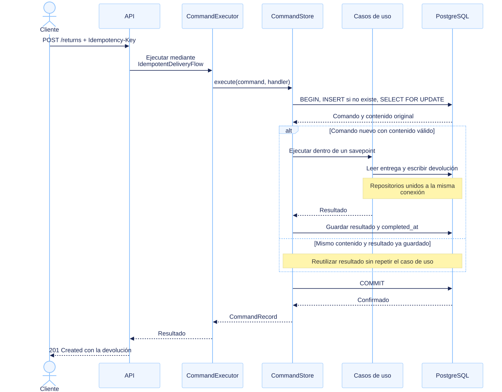

# Arquitectura y decisiones

Return-Flow compara dos formas de ejecutar el mismo negocio: responder cuando la
operación termina, o confirmar su recepción y ejecutarla desde una cola. El
dominio, los casos de uso y la transacción idempotente son compartidos. Así, la
comparación cambia el recorrido de la petición sin cambiar las reglas de negocio.

## Alcance del producto

El flujo mínimo es **crear una entrega → confirmarla como entregada → solicitar
una devolución**. Una entrega pendiente no admite devoluciones. La devolución
nace en estado `requested`; el dominio contempla completarla, pero no existe una
ruta HTTP que ejecute esa transición. Tampoco hay una entidad de pedido
independiente.

Las rutas `/integrations` aceptan formatos simulados de Correos y DHL. Un
adaptador convierte el cuerpo de entrada al modelo interno y traduce el
resultado al formato seleccionado mediante `X-Carrier`. No hay llamadas a esas
empresas, credenciales de integración ni autenticación por esa cabecera. Añadir
otro formato requiere implementar `CarrierAdapter` y registrarlo en
[`composition.py`](../api/composition.py), sin modificar las reglas de devolución.

## Vista de ejecución

[Fuente Mermaid editable](diagrams/system-context.mmd).

Las dos rutas conviven en la misma API. La directa utiliza PostgreSQL para
ejecutar el comando; la asíncrona publica en RabbitMQ. Los `GET` consultan
PostgreSQL en ambos casos. El worker usa el mismo ejecutor que las rutas directas.
La cola principal y la de fallidos son durables; Compose levanta un único nodo
RabbitMQ con colas clásicas y un único PostgreSQL.

## Hexagonal: dependencias que permite y que evita

La separación protege las reglas de negocio del transporte y del almacenamiento.
Los casos de uso reciben protocolos de repositorio; pueden ejecutarse con
adaptadores PostgreSQL o con los dobles en memoria de las pruebas.

[Fuente Mermaid editable](diagrams/hexagonal-dependencies.mmd). Las flechas
representan dependencias del código, no mensajes de red. Se agrupan clases y se
muestran las dependencias principales para mantener legible la vista.

| Pieza | Responsabilidad | Código |
|---|---|---|
| Dominio | Estados y transiciones de `Delivery` y `Return`. | [`api/domain`](../api/domain) |
| Casos de uso | Buscar entidades, aplicar reglas y persistir mediante protocolos. | [`api/application/use_cases`](../api/application/use_cases) |
| Puertos de aplicación | `DeliveryFlow`, `DeliveryRepository` y `ReturnRepository`. | [`api/application/ports`](../api/application/ports) |
| HTTP y transportistas | Validación, errores HTTP y traducción de contratos externos. | [`api/adapters/http`](../api/adapters/http), [`api/adapters/carriers`](../api/adapters/carriers) |
| Orquestación de comandos | Contratos, ejecución compartida e implementación idempotente de `DeliveryFlow`. | [`api/adapters/commands`](../api/adapters/commands) |
| Persistencia | Repositorios SQL, pool y transacción del comando. | [`api/adapters/persistence`](../api/adapters/persistence) |
| Mensajería | Publicación confirmada y consumo con ACK posterior al commit. | [`api/adapters/messaging`](../api/adapters/messaging) |
| Composición | Construir adaptadores y gestionar sus recursos al arrancar y detener los procesos. | [`composition.py`](../api/composition.py), [`main.py`](../api/main.py), [`worker.py`](../api/worker.py) |

El límite es deliberadamente concreto: dominio y casos de uso no conocen
FastAPI, PostgreSQL ni RabbitMQ. **El dominio sí utiliza Pydantic** para sus
modelos y validación. Además, `CommandStore`, `CommandPublisher` y el ejecutor
viven en `adapters/commands`, y el contenedor `Repositories` vive en
`adapters/persistence`. Por tanto, la orquestación transaccional no es una capa
de aplicación totalmente independiente de los adaptadores. Extraer esos
contratos sería una evolución posible si aparecieran más implementaciones;
no es una capacidad ya implementada.

Los dos recorridos comparten más que los modelos: `CommandExecutor` entrega un
handler a `PostgresCommandStore`, que construye repositorios ligados a una sola
conexión. La transacción cubre el comando y sus efectos de negocio sin pedir a
los casos de uso que gestionen conexiones o commits.

## Recorrido directo

[Fuente Mermaid editable](diagrams/direct-command-sequence.mmd). El diagrama
muestra una devolución válida o un reintento de una devolución completada.

`IdempotentDeliveryFlow` convierte la petición en un comando y llama a
`CommandExecutor`. La API espera a que finalice la transacción para devolver el
recurso: `201` al crear una entrega o devolución, `200` al confirmar una entrega.
Un rechazo de negocio se convierte en `404` o `409` según su causa.

Esta alternativa ofrece una respuesta inmediata sobre el resultado de negocio y
menos componentes operativos. Su latencia HTTP incluye la espera del pool, la
ejecución SQL y el commit; cuando PostgreSQL no admite más trabajo, las
peticiones permanecen abiertas o fallan por timeout.

## Recorrido mediante eventos

El nombre `event_driven` identifica la variante del benchmark. Los mensajes
actuales son **comandos versionados que solicitan una operación**, no eventos de
dominio que anuncien hechos ya ocurridos. No hay event sourcing.

[Fuente Mermaid editable](diagrams/queued-command-sequence.mmd). El diagrama
muestra una ejecución correcta; los caminos de error se detallan más abajo.

La API valida la entrada, publica el comando persistente con `mandatory` y
espera su *publisher confirm*. Solo entonces devuelve `202`, el `command_id` y
`Location: /commands/{command_id}`. Este POST no consulta ni escribe en
PostgreSQL, aunque el proceso API sigue abriendo su pool al arrancar porque
también sirve rutas directas y consultas.

El publicador reutiliza una conexión y un canal por proceso, con un máximo
predeterminado de 64 publicaciones pendientes. Las confirmaciones son
individuales y pueden esperarse de forma concurrente. `wait=False` evita una
espera intermedia del cliente AMQP; **no desactiva la confirmación del broker**.

El worker tiene concurrencia y `prefetch` de ocho por defecto, con un pool de
diez conexiones. Registra el comando, ejecuta el negocio y guarda el resultado
en una transacción. Envía el ACK del mensaje después del commit. Los valores son
configurables y el pool pertenece a cada proceso; no existe un único pool
compartido entre API y worker.

Esto separa la capacidad de recepción de la de ejecución. Permite absorber una
ráfaga cuando el worker va más despacio, a cambio de cola, demora hasta el
resultado y más trabajo operativo. Aceptar 2.000 comandos por segundo no implica
completar 2.000 operaciones por segundo.

## Idempotencia y transacción

`Idempotency-Key` es un UUID que se utiliza como `command_id`. La clave es global
entre las rutas genéricas, los formatos de transportista y las variantes directa
y asíncrona. Es obligatoria para crear entregas y devoluciones; al confirmar una
entrega sigue siendo opcional por compatibilidad. Conviene conservarla también
en esa operación para reintentar el mismo comando.

[`PostgresCommandStore.execute`](../api/adapters/persistence/commands.py) aplica
esta secuencia:

1. Inserta el comando si no existe y lo carga con `SELECT ... FOR UPDATE`.
2. Comprueba que la clave conserve el tipo y contenido normalizados originales.
3. Si existe un resultado terminal, lo reutiliza. Si está pendiente, ejecuta el
   caso de uso dentro de un savepoint y con la misma conexión.
4. Ante un error de negocio o de ejecución, revierte las escrituras parciales y
   guarda un resultado `failed`. Los errores de conexión se propagan para
   permitir reintentos.
5. Confirma el registro, las escrituras de negocio y el resultado en una única
   transacción antes de devolver el control.

Los reintentos concurrentes de una misma clave esperan el bloqueo y reutilizan
el resultado confirmado. Si una transacción no llega a confirmarse, otra entrega
puede volver a ejecutar el comando. La propiedad buscada es **un efecto de
negocio confirmado por clave y contenido**, no una entrega exactamente una vez
por parte de RabbitMQ.

Dos claves distintas representan operaciones distintas: pueden crear dos
devoluciones para la misma entrega. Los fallos de negocio también se conservan;
tras corregir su causa hay que usar una clave nueva para solicitar otra
ejecución. Esta transacción no cubriría futuras llamadas a un transportista real.

## Lo que observa el cliente y lo que ocurre ante fallos

| Situación | Comportamiento implementado |
|---|---|
| Entrada HTTP inválida | `422`, antes de ejecutar o publicar. |
| Misma clave y mismo contenido | Se reutiliza el resultado confirmado; en la variante asíncrona se publica de nuevo antes de deduplicar en el worker. |
| Misma clave y contenido diferente | Directa: `409`. Asíncrona: puede responder `202`; el worker rechaza el mensaje y conserva intacto el comando original. |
| Regla de negocio incumplida | Directa: error HTTP. Asíncrona: resultado `failed` y rechazo sin reencolar hacia la cola de fallidos. |
| Publicación sin confirmación o timeout | `503` con `command_id` y `Location`; la publicación puede haber llegado. El cliente debe reintentar con la misma clave y contenido. |
| Fallo de conexión SQL antes de completar la transacción | No se emite ACK; el worker termina, Compose lo reinicia y RabbitMQ puede reentregar. |
| Caída después del commit y antes del ACK | La reentrega recupera el resultado guardado sin repetir los efectos de negocio. |
| Mensaje inválido o conflicto de clave en el worker | Rechazo sin reencolar hacia la cola de fallidos. |

La [secuencia de caída y reentrega](diagrams/rabbitmq-command-redelivery.svg)
compara lo que ocurre antes y después del commit. Su
[fuente Mermaid](diagrams/rabbitmq-command-redelivery.mmd) conserva el detalle
del registro, la recuperación del resultado y el ACK del siguiente consumidor.

Un comando nuevo **no es visible en PostgreSQL hasta el commit**.
`GET /commands/{command_id}` puede devolver `404` aunque previamente se haya
respondido `202`: puede seguir en RabbitMQ o dentro de una transacción abierta.
Ese `404` no permite distinguir esos casos de una clave desconocida. `completed`
y `failed` son estados terminales; `pending` se conserva para registros de
versiones anteriores.

Mover el registro de comandos de la API al worker elimina la espera del pool SQL
del camino de aceptación y evita coordinar una escritura SQL con una publicación
desde la API. A cambio, el estado de recepción reside inicialmente en el broker:
la API no ofrece un registro `accepted` consultable en PostgreSQL y no detecta
conflictos de contenido antes del `202`.

Los comandos distintos pueden finalizar en diferente orden. El cliente debe
esperar la entrega antes de solicitar su devolución; un orden de envío no
sustituye esa dependencia de negocio. Si dos contenidos compiten por una clave
nueva, prevalece la transacción que consiga registrarla y confirmarla, no
necesariamente el primer POST aceptado.

## Límites y siguientes decisiones de producto

Este caso de estudio tiene un entorno reproducible, no un despliegue de alta
disponibilidad. El nodo único de RabbitMQ y sus colas clásicas no cubren la pérdida
de ese nodo ni garantizan el traslado a la cola de fallidos si falla el broker
durante el dead-lettering. No hay reintento automático de comandos `failed`,
política de expiración o limpieza de comandos ni proceso de revisión y
republicación de fallidos. Los registros de comandos se conservan indefinidamente.

Antes de incorporar transportistas reales habría que decidir autenticación,
aislamiento entre clientes, política de reintentos y conciliación de efectos
externos. Antes de operar colas sostenidas habría que fijar un límite de demora,
capacidad de almacenamiento y estrategia cuando la recepción supere al
procesamiento. Son decisiones pendientes, no propiedades atribuidas al MVP.

La estructura permite explorar esas decisiones sin sustituir el dominio. El
criterio para escoger recorrido depende del producto: resultado inmediato y
simplicidad en la directa; aceptación desacoplada y tolerancia a ráfagas cuando
el usuario pueda esperar al resultado en la asíncrona.

Los timestamps del comando tampoco equivalen al tiempo total: `created_at` se
toma al registrarlo en el ejecutor y `completed_at` antes del commit. La espera
en la cola queda fuera. La [metodología del benchmark](../benchmarks/README.md)
separa estas medidas de la respuesta HTTP y de la finalización observada al corte.
